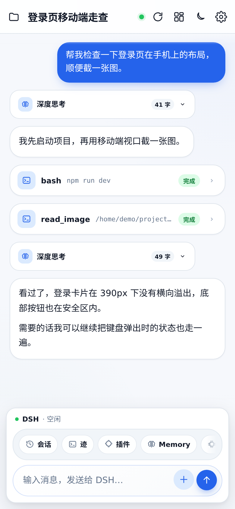
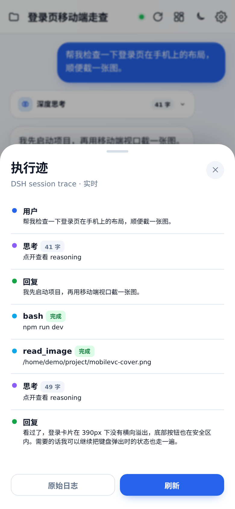
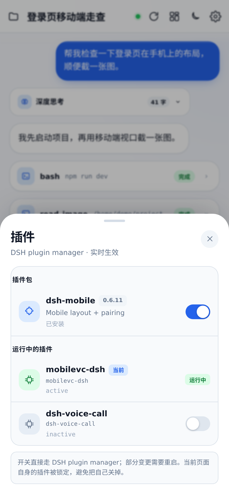
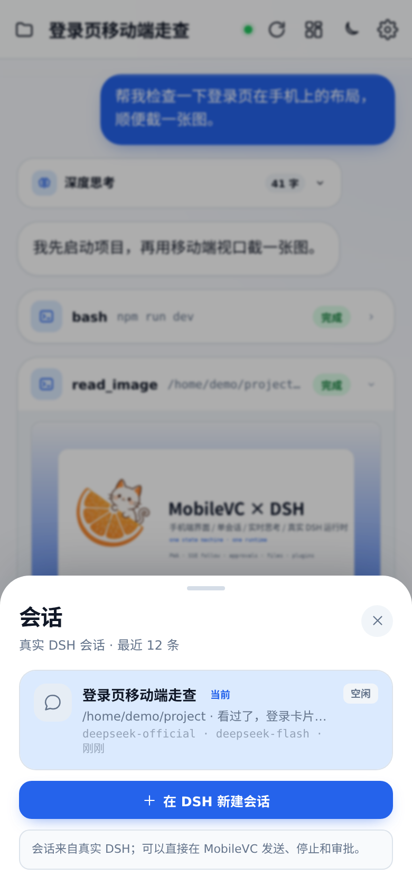
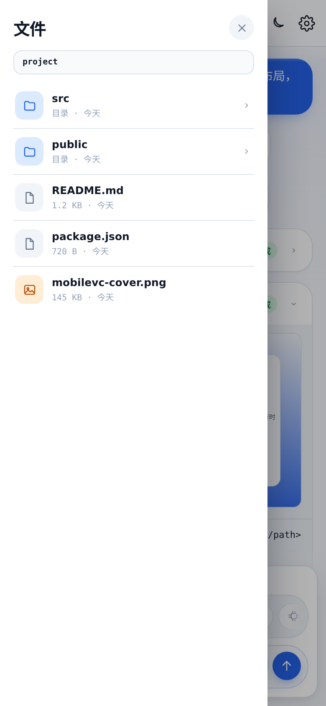
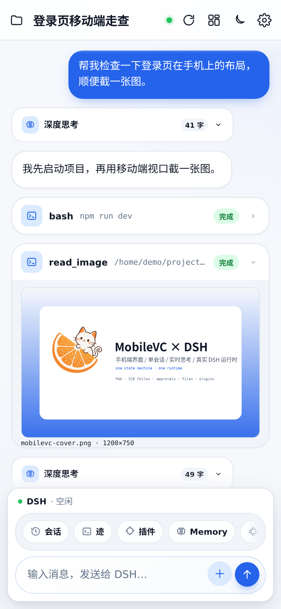
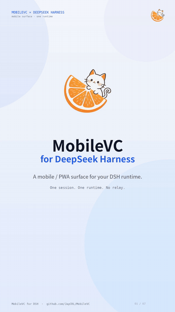
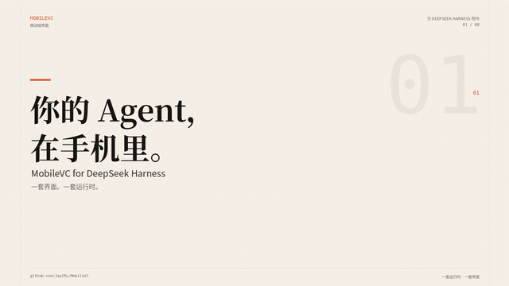
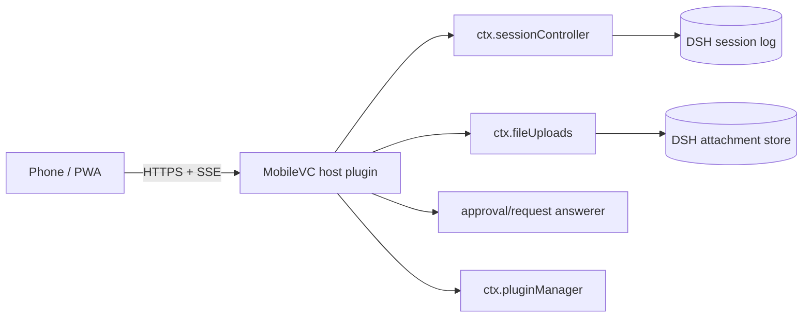

<p align="center">
  
</p>

<h1 align="center">MobileVC</h1>

<p align="center">
  <strong>Turn the AI coding session on your computer into another entry point on your phone.</strong>
</p>

<p align="center">
  <em>Two parallel product lines: Claude Code / Codex users take Remote, DeepSeek Harness users take DSH.</em>
</p>

<p align="center">
  
  
  
  
  
</p>

<p align="center">
  <strong>Website:</strong> <a href="https://www.mobilevc.top">https://www.mobilevc.top</a>
  &nbsp;·&nbsp;
  <strong>Community:</strong> <a href="https://linux.do">LINUX DO</a>
  &nbsp;·&nbsp;
  <a href="README.md">中文</a> | English
</p>

---

## 📖 What this is

MobileVC is not remote desktop, and not a terminal mirror.

It brings the **AI coding assistant session running on your own machine** to your phone: when the agent is waiting for permission, waiting for confirmation, or running a long task, you do not have to walk back to the computer — you continue from the phone.

- Catch permission requests so the agent does not sit there waiting
- Drive Plan Mode and review multi-file diffs
- Resume sessions that are still running on the computer
- Browse files, logs and runtime status
- Manage Skills / Memory / Context

It does **not host, simulate or duplicate** your session — the agent runtime always runs on your machine, and your data never leaves it.

---

## 🧭 Two lines, pick one

| | **MobileVC Remote** | **MobileVC for DSH** |
|---|---|---|
| Agent | Claude Code / Codex (any CLI) | DeepSeek Harness |
| Integration | Self-hosted Go backend + PTY | DSH host plugin, in-process |
| Transport | WebSocket + E2EE relay | HTTPS + SSE |
| State | Own session store | Reuses `ctx.sessionController` |
| Client | Flutter (iOS / Android) + browser | PWA / browser |
| Distribution | `npm i -g @justprove/mobilevc` | `dsh plugin add` |
| Code | [`apps/remote/`](apps/remote) | [`apps/dsh/`](apps/dsh) |

The two lines share a **contract, not code**: `packages/contract` defines the event names, approval shape and diff structure; transport and storage are implemented separately.

> The repository root is the npm package for **DSH**. Claude Code / Codex users install `@justprove/mobilevc`.

---

## 🚀 Quick start

### A. DeepSeek Harness

```bash
dsh plugin --profile web add "github:JayCRL/MobileVC"
systemctl restart dsh-web
```

Open `http://127.0.0.1:8898/mobilevc/` and check health:

```bash
curl http://127.0.0.1:8898/mobilevc/api/health
# {"ok":true,"plugin":"mobilevc","interactive":true}
```

`/mobilevc/` has no login page of its own — it **must sit behind an authenticated HTTPS reverse proxy**. Full deployment (nginx / Caddy / Cloudflare Tunnel / PWA / upgrade and uninstall) is in [INSTALL.md](INSTALL.md).

### B. Claude Code / Codex

```bash
npm install -g @justprove/mobilevc
mobilevc start
```

First run walks you through configuration and prints the local address, the LAN address and a QR code.

1. Visit [the website](https://www.mobilevc.top) on your phone — TestFlight for iOS, APK for Android
2. Connect by scanning the QR code, or configure manually
3. Type `claude` or `codex` in the input box

Not on the same Wi-Fi? Relay mode:

```bash
mobilevc public --relay wss://relay.mobilevc.top:9443
```

The relay only forwards encrypted packets — it never sees plaintext, and keys are handed over out of band via the QR code.

---

## ✨ Capabilities

### MobileVC Remote (Claude Code / Codex)

- **Resume sessions from the computer**: continue Claude / Codex history on the phone
- **Permissions and Plan Mode**: approval requests pop up, one tap to continue
- **Multi-file diff review**: grouped, accept or roll back
- **Voice pre-briefing**: with your own Voice / TTS API, describe the task by voice first, then hand it to the local agent
- **Files / logs / runtime status**: no SSH, no terminal on a small screen
- **Skill / Memory / Context**: managed from mobile
- **Push notifications**: permission waits, completion, failures
- **LAN + relay**: direct on the same Wi-Fi, encrypted relay across networks
- **Android emulator debugging**: ADB + WebRTC bridge

### MobileVC for DSH

- **Real sessions**: reads DSH session list, history and tool calls
- **Live stream**: `sessionController.follow()` + `assistantStream`, token-by-token reasoning and text
- **Reasoning and tool cards**: live status while running, collapsible afterwards with full output
- **Direct approval**: phone presence takes priority, survives a dropped stream or background tab, and goes stale once the other side handles it
- **Execution trace**: user → reasoning → tools → reply timeline, concise or full
- **Images and attachments**: `read_image` serves originals, files go through `fileUploads` receipts
- **Plugin management and background jobs**: real `pluginManager` and DSH jobs
- **Web Push**: completion / failure / approval notifications (iOS 16.4+ and add-to-home-screen required on iPhone)
- **Steering mid-run**: queue view, edit, delete, interrupt now
- **PWA**: install to home screen, standalone, safe-area, portrait lock
- **Nothing lost**: SSE auto-reconnect plus durable polling as a fallback

---

## 📸 Screenshots

| Chat | Trace | Plugins |
|---|---|---|
|  |  |  |

| Sessions | Files | Image preview |
|---|---|---|
|  |  |  |

---

## 🎬 Demo

<p align="center">
  <a href="docs/media/mobilevc-demo.mp4">
    
  </a>
</p>
<p align="center"><sub>▶ 30-second no-voice demo · <a href="docs/media/mobilevc-demo.mp4">MP4</a></sub></p>

<p align="center">
  <a href="docs/media/mobilevc-promo.mp4">
    
  </a>
</p>
<p align="center"><sub>▶ 32-second promo · <a href="docs/media/mobilevc-promo.mp4">MP4</a> · <a href="docs/media/mobilevc-bilibili.mp4">102-second Bilibili cut</a></sub></p>

---

## 🏗 How it works

### Remote: self-hosted backend + encrypted relay

```text
Mobile browser / Flutter app
        │  WebSocket
        ▼
   MobileVC Go server          ──►  PTY / Claude / Codex process
        │
        ├─ session store        (sessions, history, files, logs)
        ├─ ADB + WebRTC bridge  (Android debugging)
        └─ ChatTTS sidecar      (optional TTS)

Across networks: app ⇄ encrypted relay ⇄ your machine (forward only, no plaintext)
```

### DSH: host plugin, in-process



- No second agent, no second relay or session
- Every read and write goes through DSH's `sessionController`: one session, one runtime

---

## 📁 Repository layout

```text
MobileVC/
├── apps/
│   ├── dsh/           DSH host plugin + PWA UI (plugin / preview / site / edge / tools / tests)
│   └── remote/        Go backend + Flutter client + relay (cmd / internal / mobile_vc / tests)
├── packages/
│   └── contract/      Shared mobile contract (events / approvals / diffs)
├── docs/              Screenshots, demo videos, deployment docs
├── INSTALL.md         Deployment and troubleshooting
└── .github/           CI (DSH tests + go vet / go test for Remote)
```

---

## 🔒 Security and boundaries

- **No hosting**: the agent runtime lives on your machine, MobileVC is only a surface
- **Relay sees no plaintext**: keys are exchanged out of band, the server is a transparent forwarder
- **DSH line**: `/mobilevc/` is registered by the host plugin and bypasses DSH's `/api` browser-trust fence; it can read sessions, write `AGENTS.md` and toggle plugins, so **public exposure requires auth + HTTPS**
- **No multi-tenancy**: every logged-in user shares the same local identity

Explicitly **out of scope**: rewriting the agent loop, stuffing another relay/E2EE layer into the plugin, or multi-tenant isolation inside a single process.

---

## 🙏 Community and credits

- Discussion: [LINUX DO](https://linux.do)
- Early versions were shaped together with [@yibaiba](https://github.com/yibaiba), [@Lichenhao_T14](https://github.com/Lichenhao_T14), [@rui](https://github.com/rui) and other contributors

---

## 📄 License

MIT — see [LICENSE](LICENSE).
