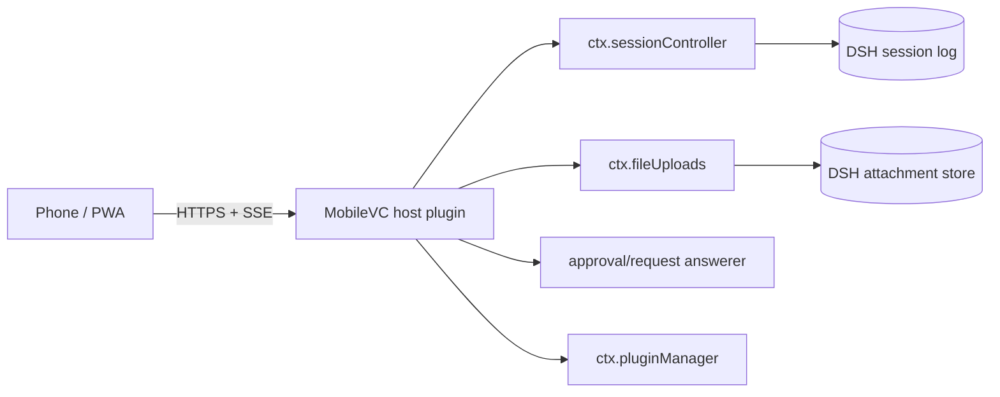

# MobileVC

**A MobileVC-style mobile / PWA surface for DeepSeek Harness.**

[中文](README.md) | English

<p align="center">
  <a href="docs/media/mobilevc-demo.mp4">
    
  </a>
</p>
<p align="center"><sub>▶ 30-second no-voice intro · <a href="docs/media/mobilevc-demo.mp4">MP4</a></sub></p>

MobileVC gives DSH a phone-first interface. Connect it to your running DSH and use the same sessions: read history, send prompts, interrupt a run, approve tools, attach images/files, browse the workspace and manage plugins.

It is not a second Agent and not another relay or session store. Every read and write goes through DSH's `sessionController`: **one session, one runtime**.

- Version: `0.1.0`
- Tested with: DSH `0.2.0-rc.2`, Node 22+
- Shape: DSH Host plugin + static PWA UI
- Screenshots: `docs/images/`
- Video: `docs/media/mobilevc-demo.mp4`

## Features

- **Real sessions** — DSH session list, history and tool calls
- **Live stream** — `sessionController.follow()` with `assistantStream`; token-level reasoning and text
- **Reasoning cards** — “thinking” while running, then a collapsible “deep thinking · N chars” card
- **Tool cards** — collapsed by default; name, args and status; tap for full output
- **Image previews** — `read_image` reads the original from the DSH attachment store; thumbnail + full screen
- **Attachments** — images as image parts; files via `fileUploads` receipts
- **Direct approvals** — allow once / reject; a stale click becomes a no-op
- **Trace** — user → thinking → tool → reply → compaction timeline
- **Files** — real workspace, breadcrumbs and subdirectory browsing
- **Plugin manager** — real `pluginManager` list and toggles
- **PWA** — home-screen install, standalone, safe-area, no pinch/double-tap zoom
- **Visible failures** — quota/model failures become error cards instead of silence

## Screenshots

| Chat | Trace | Plugins |
|---|---|---|
|  |  |  |

More: `docs/images/sessions.png`, `docs/images/files.png`, `docs/images/image-preview.png`.

## Install

You need a machine already running DSH Web.

### As a DSH bundle (recommended)

```bash
dsh plugin --profile web add "github:JayCRL/MobileVC"
systemctl restart dsh-web
```

Or from a local clone:

```bash
git clone https://github.com/JayCRL/MobileVC.git mobilevc
dsh plugin --profile web add ./mobilevc
systemctl restart dsh-web
```

Open:

```text
http://127.0.0.1:8898/mobilevc/
```

Health check:

```bash
curl http://127.0.0.1:8898/mobilevc/api/health
# {"ok":true,"plugin":"mobilevc","interactive":true}
```

### Self-host edge (optional)

`edge/` packages Caddy + an optional cloudflared tunnel, so users do not have to write nginx or an auth proxy:

```bash
cd edge
cp .env.example .env
./hash-password.sh
docker compose --profile tunnel up -d
```

See [edge/README.md](./edge/README.md). It packages the edge only; DSH and its runtime stay on the user's machine.

Deployment, nginx, PWA, upgrade/uninstall and troubleshooting: [INSTALL.en.md](./INSTALL.en.md) · [中文部署说明](./INSTALL.md).

> `/mobilevc/` has no login screen of its own. Put it behind an authenticating HTTPS reverse proxy.

## Usage

- **+** — attach an image or file
- **Enter** send, **Shift+Enter** newline
- While running, the red pulse button right of Send interrupts the current turn
- Tap a tool card to expand its output
- Tap a `read_image` thumbnail for full screen
- **Trace** — execution timeline
- **Plugins** — DSH plugin management
- **Memory** — read/write real `AGENTS.md`
- Approval card — Reject / Allow once

## Architecture



- `/mobilevc/api/follow` → `sessionController.follow({ assistantStream: true })`
- `/mobilevc/api/prompt` → `sessionController.prompt()`; images as image parts, files first uploaded through `fileUploads.uploadStream()` for a receipt
- `/mobilevc/api/approval` → mobile answerer; with no active follow it delegates with `next()` to the desktop
- `/mobilevc/api/plugins` → `pluginManager`
- UI and API are same-origin; no CORS

## Remote access / no public IP

A browser cannot dial into a NATed DSH by itself. Two options:

1. **Personal / friends**: Cloudflare Tunnel or Tailscale exposes `127.0.0.1:8898` as a reachable URL. No code changes.
2. **Product**: a central Relay + a `mobilevc-connect` plugin. DSH dials out; the Relay is a transparent tunnel and stores no session.

This repository provides the Host plugin and UI; it does not bundle a Relay.

## Security

`/mobilevc/` is registered by a Host plugin and does not go through DSH's `/api` browser-trust fence. It can:

- read every session, log and workspace file
- send prompts, stop runs, approve tool calls
- write `AGENTS.md`
- upload images/files
- enable/disable DSH plugins

All authenticated users share one DSH identity; there is no multi-tenant isolation. Use authentication and HTTPS on the public edge; never expose port 8898 directly.

## Direction

- Cut a proper release
- Finer trace: step grouping and tool durations
- Attachment UX: paste, camera, drag/drop
- Approval presence: mobile-first when a mobile follow is active, desktop otherwise
- Optional native shell over the same PWA/HTTP surface; no second runtime

Not planned: rewriting the Agent loop, adding another relay/E2EE layer inside the plugin, or multi-tenant isolation inside one DSH process.

## Relation to the original MobileVC

The original app was a Flutter client + Go relay + E2EE. It is preserved under [`legacy/`](https://github.com/JayCRL/MobileVC/tree/main/legacy) and in git history, but it is no longer the default client.

The move to DSH is deliberate: DSH already provides the Agent runtime, durable session log, follow stream, approvals and plugin system. Keeping the Flutter client and relay would mean maintaining a second session/queue/runtime outside DSH — exactly where the old sync and queue problems came from.

Today there is one rule:

> **DSH owns the runtime. MobileVC owns the surface.**

The old app remains for historical reference; new deployments should use the DSH install above.

## License

MIT — see [LICENSE](./LICENSE).
