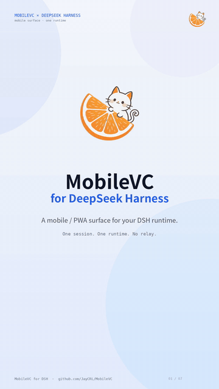
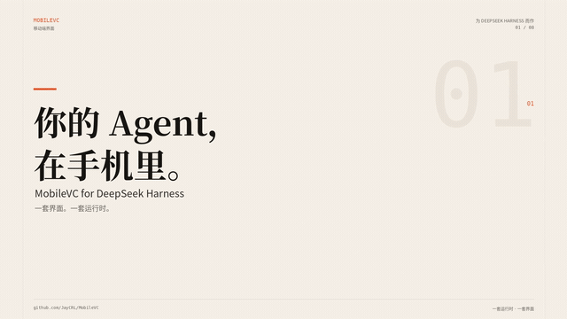
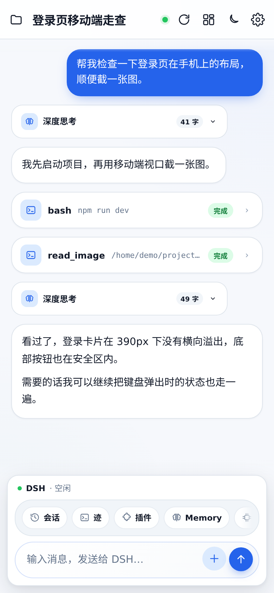
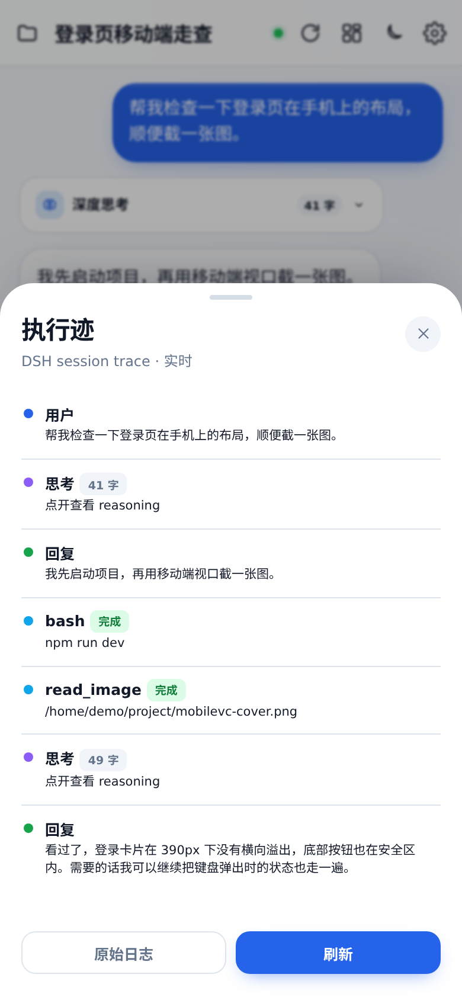
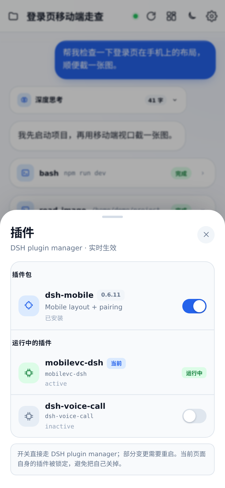
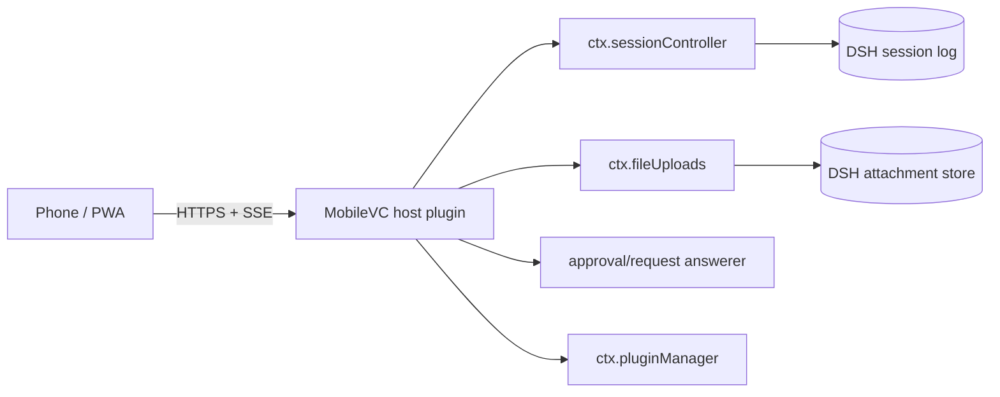

# MobileVC

**MobileVC-style mobile / PWA surface for DeepSeek Harness.**

中文 | [English](README.en.md)

<p align="center">
  <a href="docs/media/mobilevc-demo.mp4">
    
  </a>
</p>
<p align="center"><sub>▶ 30 秒无配音演示 · <a href="docs/media/mobilevc-demo.mp4">MP4</a></sub></p>

MobileVC 给 DSH 加一个手机端界面：连上你正在跑的 DSH，直接看会话、发消息、打断、审批、传图片/文件、管理插件。

它不是第二个 Agent，也不是另一套 relay/session。所有读写都走 DSH 的 `sessionController`，**一套会话，一套运行时**。

- 版本：`0.1.0`
- 验证环境：DSH `0.2.0-rc.2`、Node 22+
- 形态：DSH Host plugin + 静态 PWA UI
- 官网：https://mobilevc.top/
- 截图：`docs/images/`
- 演示：`docs/media/mobilevc-demo.mp4`
- 宣传片：`docs/media/mobilevc-promo.mp4`

## 新版宣传片

<p align="center">
  <a href="docs/media/mobilevc-promo.mp4">
    
  </a>
</p>
<p align="center"><sub>32 秒 · 中文纯文字 · 无配音 / 无字幕 · 仅轻音乐</sub></p>

## 功能

- **真实会话**：读取 DSH 的会话列表、历史、工具调用
- **实时流**：`sessionController.follow()` + `assistantStream`，逐 token 的思考/正文
- **思考卡**：执行中显示“正在思考”，结束后变成可折叠的“深度思考 · N 字”
- **工具卡**：默认折叠，显示工具名/参数/状态，点开看完整输出
- **图片预览**：`read_image` 从 DSH attachment store 读原图，缩略图 + 全屏
- **附件**：图片作为 image part；文件通过 `fileUploads` receipt 发送
- **直接审批**：手机 presence 优先；断流/切后台也能接住；另一端已处理时点击自动失效
- **执行迹**：用户 → 思考 → 工具 → 回复 → 压缩的 timeline；默认简洁模式，按思考/工具链分组，英文原文和工具参数折叠，可切「完整」
- **文件**：真实工作区，面包屑 + 逐级浏览
- **插件管理**：真实 `pluginManager` 列表与开关
- **账号余额**：底部实时余额；余额不足自动打开 DeepSeek 官方充值页
- **后台任务**：显示 DSH jobs，查看输出、停止；长命令不再只能前台干等
- **Web Push**：完成 / 失败 / 审批通知；iPhone 需 iOS 16.4+ 并加到主屏幕
- **执行中插话**：队列展示、修改、删除、立即插话
- **PWA**：主屏幕安装、standalone、safe-area、竖屏锁定、禁双指/双击缩放
- **不掉记录**：SSE 断开自动重连 + durable 轮询兜底，新回复不需要手动刷新
- **错误可见**：额度/模型失败变成错误卡，不再静默

## 截图

| 对话 | 执行迹 | 插件 |
|---|---|---|
|  |  |  |

更多：`docs/images/sessions.png`、`docs/images/files.png`、`docs/images/image-preview.png`。

## 安装

需要一台已经能跑 DSH Web 的机器。

### 作为 DSH bundle（推荐）

```bash
dsh plugin --profile web add "github:JayCRL/MobileVC"
systemctl restart dsh-web
```

或者本地 clone：

```bash
git clone https://github.com/JayCRL/MobileVC.git mobilevc
dsh plugin --profile web add ./mobilevc
systemctl restart dsh-web
```

打开：

```text
http://127.0.0.1:8898/mobilevc/
```

健康检查：

```bash
curl http://127.0.0.1:8898/mobilevc/api/health
# {"ok":true,"plugin":"mobilevc","interactive":true}
```

### 自部署边缘（可选）

如果你想把“反代 + 登录 + Cloudflare Tunnel”一起交给用户，`edge/` 目录提供 Caddy + 可选 cloudflared 的 compose：

```bash
cd edge
cp .env.example .env
./hash-password.sh
docker compose --profile tunnel up -d
```

详见 [edge/README.md](./edge/README.md)。它只封装入口，不包含 DSH 或 Agent runtime。

完整部署、nginx、PWA、升级/卸载、排错：[INSTALL.md](./INSTALL.md)。

> `/mobilevc/` 没有独立登录页，必须放在认证 HTTPS 反向代理后面。

## 使用

- **+**：发送图片或文件
- **Enter** 发送，**Shift+Enter** 换行
- 运行中，发送键右侧红色停止按钮：打断当前 turn
- 运行中发消息：进入插话队列，自动打开面板，可修改 / 删除 / 立即插话
- 横屏：显示竖屏提示，不切桌面横向布局
- 点工具卡：展开输出
- 点 `read_image` 缩略图：全屏
- **迹**：执行 timeline
- **插件**：DSH 插件管理
- **Memory**：读写真实 `AGENTS.md`
- 审批卡：拒绝 / 允许一次
- **设置 → 通知 → 开启**：启用 Web Push；**测试**可发一条测试通知

## 通知（Web Push）

- 触发：任务完成、任务失败、等待审批、后台任务结束
- 不需要公网 IP：DSH 主机主动向 Apple/Google 推送服务发起 HTTPS
- iPhone：iOS 16.4+，必须“添加到主屏幕”后从图标启动，Safari 标签页不支持
- 通知里不包含完整会话内容；点击打开 MobileVC
- 页面正在前台时不会重复推送，离开后由 Web Push 接管

## 架构



- `/mobilevc/api/follow` → `sessionController.follow({ assistantStream: true })`
- `/mobilevc/api/prompt` → `sessionController.prompt()`；图片直接作为 image part，文件先 `fileUploads.uploadStream()` 换 receipt
- `/mobilevc/api/approval` → 手机 presence answerer；没有活跃 follow/presence 时 `next()` 交回桌面
- `/mobilevc/api/queue` → `resolveAgent().inbox` 列出插话，`updateQueue()` 修改/删除/steer
- `/mobilevc/api/plugins` → `pluginManager`
- 页面和 API 同源，不需要 CORS

## 远程访问 / 没有公网 IP

浏览器不能直接连进 NAT 后的 DSH。两种做法：

1. **自己/朋友**：Cloudflare Tunnel 或 Tailscale，把本机 8898 变成一个可达 URL；不改代码
2. **产品化**：中心 Relay + `mobilevc-connect` 插件，DSH 主动外连；Relay 只做透明隧道，不存 session

当前仓库只提供 Host plugin 和 UI，不内置 Relay。

## 安全

`/mobilevc/` 由 Host plugin 注册，不走 DSH `/api` 的 browser-trust fence。它可以：

- 读所有会话、日志、工作区文件
- 发消息、停止、审批
- 写 `AGENTS.md`
- 上传图片/文件
- 启用/禁用 DSH 插件

所有登录用户共享同一个 DSH 身份，没有多租户隔离。公网必须使用认证 + HTTPS，不要把 8898 裸露。

## 方向

- 发布正式版本 / release
- 执行迹细化：step 分组、工具耗时
- 附件体验：粘贴、相机、拖拽
- 插话队列的键盘、滚动和多条消息体验
- 可选原生壳复用同一套 PWA/HTTP surface；不引入第二套 runtime

不做：重写 Agent loop、在插件里再塞 relay/E2EE、单 DSH 进程内做多租户隔离。

## 与旧版 MobileVC 的关系

旧版是 Flutter 客户端 + Go relay + E2EE。它保留在 [`legacy/`](https://github.com/JayCRL/MobileVC/tree/main/legacy)，也保留在 git 历史里，但不再是默认客户端。

转向 DSH 的原因很简单：DSH 已经提供 Agent runtime、durable session log、follow 流、审批和插件系统。继续维护 Flutter + relay，等于在 DSH 之外再维护一套 session/queue/runtime，这会重新引入同步和队列问题。

现在只保留一层：

> **DSH owns the runtime. MobileVC owns the surface.**

旧版仅作历史参考；新部署请使用上面的 DSH 安装方式。

## License

MIT — see [LICENSE](./LICENSE).
