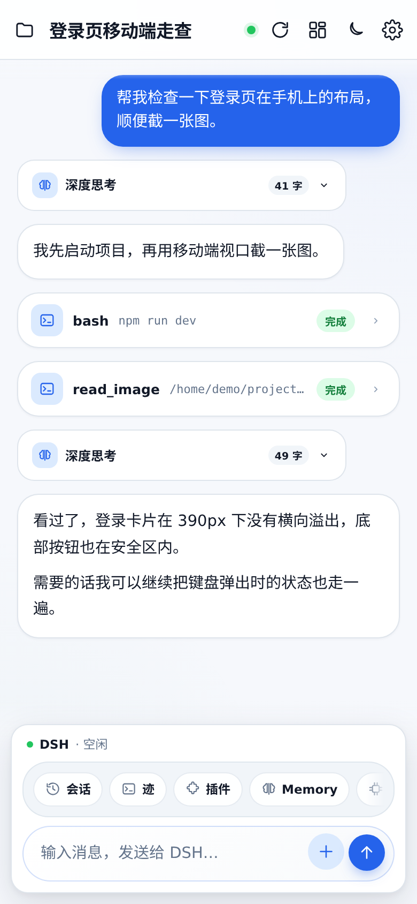
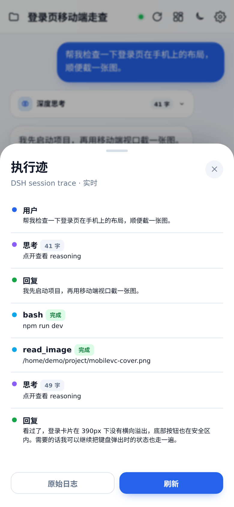
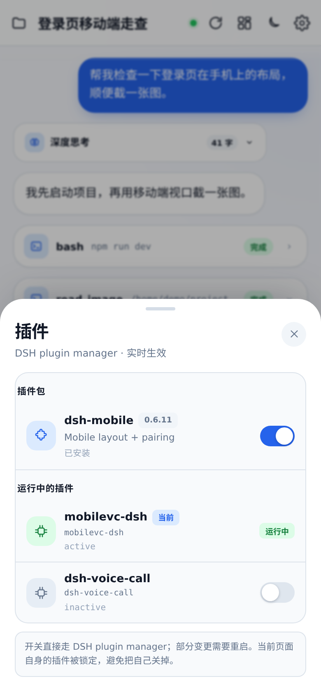
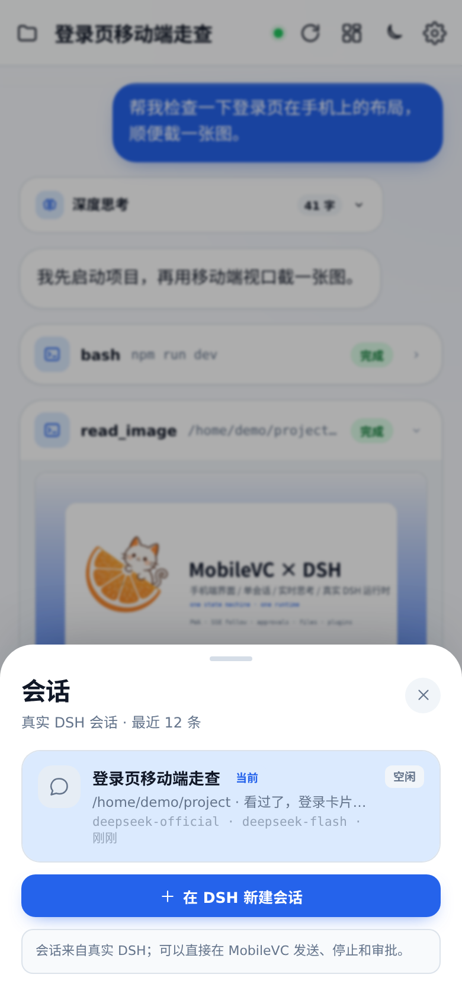
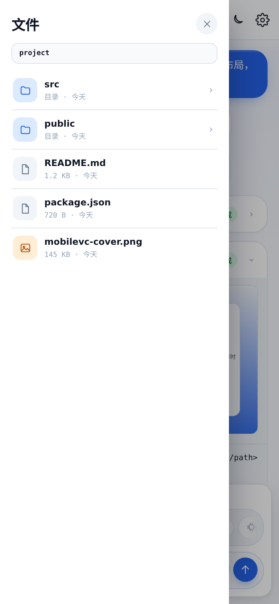
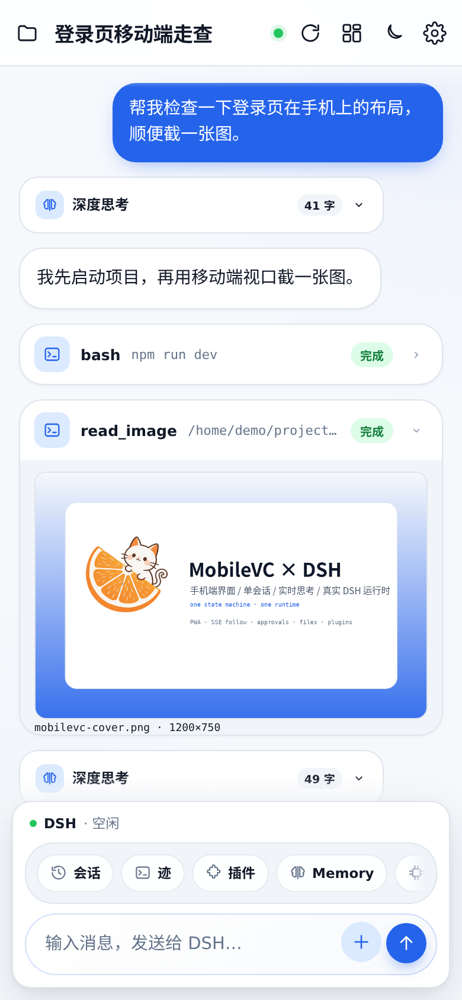
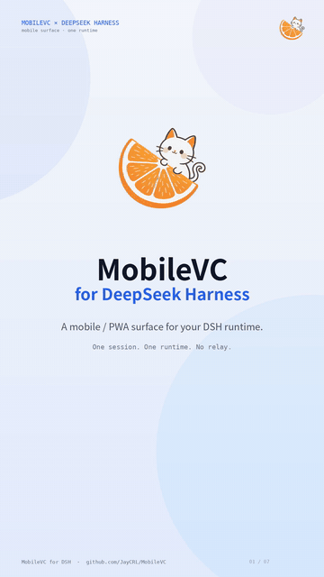
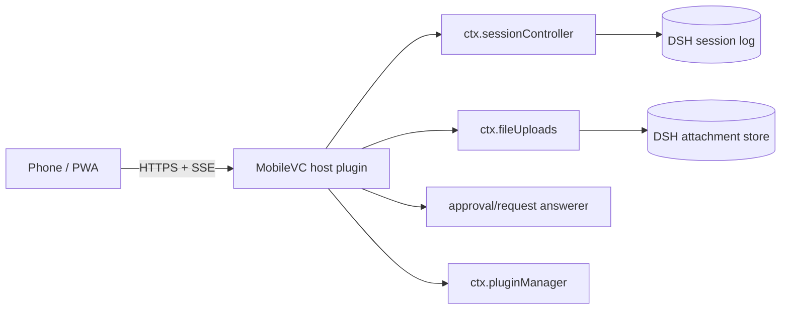

<p align="center">
  
</p>

<h1 align="center">MobileVC</h1>

<p align="center">
  <strong>把电脑上的 AI 编程会话，变成手机上的另一个入口。</strong>
</p>

<p align="center">
  <em>两条并行的产品线：用 Claude Code / Codex 走 Remote，用 DeepSeek Harness 走 DSH。</em>
</p>

<p align="center">
  
  
  
  
  
</p>

<p align="center">
  <strong>官网：</strong><a href="https://www.mobilevc.top">https://www.mobilevc.top</a>
  &nbsp;·&nbsp;
  <strong>社区：</strong><a href="https://linux.do">LINUX DO</a>
  &nbsp;·&nbsp;
  中文 | <a href="README.en.md">English</a>
</p>

---

## 📖 这是什么

MobileVC 不是远程桌面，也不是终端镜像。

它把**跑在你自己电脑上的 AI 编程助手会话**带到手机上：AI 在等权限、等确认、跑长任务的时候，你不需要回到电脑前，掏出手机就能继续推进。

- 接住权限请求，不让 agent 停在原地干等
- 推进 Plan Mode、审核多文件 diff
- 恢复电脑上正在跑的历史会话
- 浏览文件、日志、运行状态
- 管理 Skill / Memory / Context

它**不托管、不模拟、不复制**你的会话——Agent runtime 始终跑在你自己的机器上，数据不出本机。

---

## 🧭 两条线，选一条

| | **MobileVC Remote** | **MobileVC for DSH** |
|---|---|---|
| 你用什么 agent | Claude Code / Codex 等任意 CLI | DeepSeek Harness |
| 接入方式 | 自建 Go 后端 + PTY | DSH Host plugin，进程内直连 |
| 传输 | WebSocket + E2EE Relay | HTTPS + SSE |
| 状态机 | 自维护 | 复用 `ctx.sessionController` |
| 客户端 | Flutter（iOS / Android）+ 浏览器 | PWA / 浏览器 |
| 分发 | `npm i -g @justprove/mobilevc` | `dsh plugin add` |
| 代码 | [`apps/remote/`](apps/remote) | [`apps/dsh/`](apps/dsh) |

两条线**共享的不是代码，是契约**：`packages/contract` 定义事件名、审批形状和 diff 结构，传输层与存储各自实现。

> 本仓库根目录就是 **DSH 版**的 npm 包；Claude Code / Codex 用户请直接用 `@justprove/mobilevc`。

---

## 🚀 快速开始

### A. 用 DeepSeek Harness

```bash
dsh plugin --profile web add "github:JayCRL/MobileVC"
systemctl restart dsh-web
```

打开 `http://127.0.0.1:8898/mobilevc/`，健康检查：

```bash
curl http://127.0.0.1:8898/mobilevc/api/health
# {"ok":true,"plugin":"mobilevc","interactive":true}
```

`/mobilevc/` 没有独立登录页，**必须放在认证 HTTPS 反向代理后面**。完整部署（nginx / Caddy / Cloudflare Tunnel / PWA / 升级卸载）见 [INSTALL.md](INSTALL.md)。

### B. 用 Claude Code / Codex

```bash
npm install -g @justprove/mobilevc
mobilevc start
```

首次启动会引导配置，并打印本机地址、局域网地址和二维码。

1. 手机访问 [官网首页](https://www.mobilevc.top)，iOS 走 TestFlight，Android 下载 APK
2. 扫码连接或手动配置
3. 在输入框输入 `claude` 或 `codex` 开始

不在同一 WiFi 下也能连：

```bash
mobilevc public --relay wss://relay.mobilevc.top:9443
```

Relay 只转发加密数据包，服务器看不到明文，密钥通过扫码带外传递。

---

## ✨ 主要能力

### MobileVC Remote（Claude Code / Codex）

- **继续电脑上的会话**：Claude / Codex 历史会话在手机上续接
- **权限与 Plan Mode**：审批请求直接弹出，点一下就继续
- **多文件 diff 审核**：按组查看，可接受或回滚
- **语音预沟通**：自配 Voice / TTS API 后，先用语音把任务说清楚，再交给本机 agent 执行
- **文件 / 日志 / 运行态**：不用 SSH，不用看终端
- **Skill / Memory / Context**：移动端管理
- **推送通知**：权限等待、任务完成、失败
- **局域网 + Relay**：同 WiFi 直连，跨网走加密中继
- **Android 模拟器调试**：ADB + WebRTC 桥接

### MobileVC for DSH

- **真实会话**：读取 DSH 的会话列表、历史、工具调用
- **实时流**：`sessionController.follow()` + `assistantStream`，逐 token 的思考与正文
- **思考卡 / 工具卡**：执行中显示状态，结束后折叠，点开看完整输出
- **直接审批**：手机 presence 优先，断流或切后台也能接住，另一端已处理时自动失效
- **执行迹**：用户 → 思考 → 工具 → 回复的 timeline，简洁 / 完整两档
- **图片与附件**：`read_image` 读原图，文件通过 `fileUploads` receipt 发送
- **插件管理 / 后台任务**：真实 `pluginManager` 与 DSH jobs
- **Web Push**：完成 / 失败 / 审批通知（iPhone 需 iOS 16.4+ 并添加到主屏幕）
- **执行中插话**：队列展示、修改、删除、立即插话
- **PWA**：主屏幕安装、standalone、safe-area、竖屏锁定
- **不掉记录**：SSE 断开自动重连 + durable 轮询兜底

---

## 📸 界面

| 对话 | 执行迹 | 插件 |
|---|---|---|
|  |  |  |

| 会话 | 文件 | 图片预览 |
|---|---|---|
|  |  |  |

---

## 🎬 演示

<p align="center">
  <a href="docs/media/mobilevc-demo.mp4">
    
  </a>
</p>
<p align="center"><sub>▶ 30 秒无配音演示 · <a href="docs/media/mobilevc-demo.mp4">MP4</a></sub></p>

<p align="center">
  <a href="docs/media/mobilevc-promo.mp4">
    
  </a>
</p>
<p align="center"><sub>▶ 32 秒宣传片 · <a href="docs/media/mobilevc-promo.mp4">MP4</a> · <a href="docs/media/mobilevc-bilibili.mp4">B 站 102 秒版</a></sub></p>

---

## 🏗 它是怎么工作的

### Remote：自建后端 + 加密 Relay

```text
Mobile browser / Flutter app
        │  WebSocket
        ▼
   MobileVC Go server          ──►  PTY / Claude / Codex 进程
        │
        ├─ session store        （会话、历史、文件、日志）
        ├─ ADB + WebRTC bridge  （Android 调试）
        └─ ChatTTS sidecar      （可选 TTS）

跨网时：App ⇄ 加密 Relay ⇄ 你的机器（Relay 只转发，不存明文）
```

### DSH：宿主插件，进程内直连



- 没有第二个 Agent、没有第二套 relay/session
- 所有读写走 DSH 的 `sessionController`，一套会话、一套运行时

---

## 📁 仓库结构

```text
MobileVC/
├── apps/
│   ├── dsh/           DSH host plugin + PWA UI（plugin / preview / site / edge / tools / tests）
│   └── remote/        Go 后端 + Flutter 客户端 + Relay（cmd / internal / mobile_vc / tests）
├── packages/
│   └── contract/      两条线共用的移动端交互契约（事件 / 审批 / diff）
├── docs/              截图、演示视频、部署文档
├── INSTALL.md         部署与排错
└── .github/           CI（DSH 单测 + Remote 的 go vet / go test）
```

---

## 🔒 安全与边界

- **不托管**：Agent runtime 在你的机器上，MobileVC 只是入口
- **Relay 不存明文**：密钥扫码带外传递，服务端只做透明转发
- **DSH 版**：`/mobilevc/` 由 Host plugin 注册，不走 DSH `/api` 的 browser-trust fence；它能读会话、写 `AGENTS.md`、开关插件，**公网必须加认证 + HTTPS**
- **无多租户**：所有登录用户共享同一个本地身份

明确**不做**的事：重写 Agent loop、在插件里再塞一套 relay/E2EE、单进程内做多租户隔离。

---

## 🙏 社区与致谢

- 讨论：[LINUX DO](https://linux.do)
- 早期版本由 [@yibaiba](https://github.com/yibaiba)、[@Lichenhao_T14](https://github.com/Lichenhao_T14)、[@rui](https://github.com/rui) 等贡献者共同打磨

---

## 📄 协议

MIT — 见 [LICENSE](LICENSE)。
