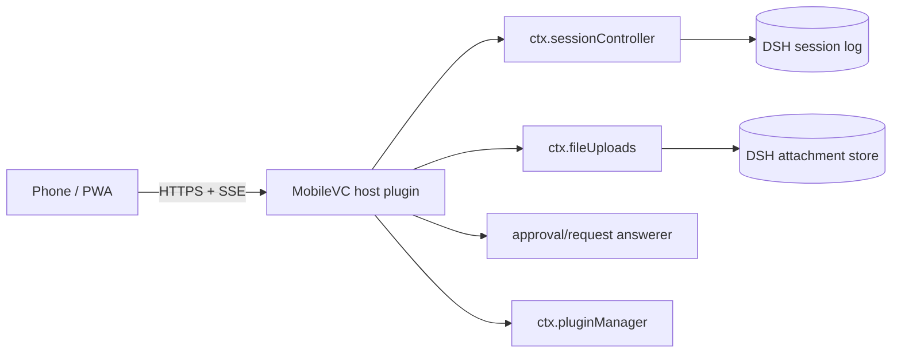

# MobileVC

**把跑在你机器上的 AI 编程会话，变成手机上的另一个入口。**

中文 | [English](README.en.md)

本仓库同时维护两条**并行**的产品线，它们共享同一个承诺，接入方式不同：

| | **MobileVC for DSH** | **MobileVC Remote** |
|---|---|---|
| 你用什么 agent | DeepSeek Harness | Claude Code / Codex 等任意 CLI |
| 接入方式 | DSH Host plugin，进程内直连 | 自建 Go 后端 + PTY，LAN / Relay |
| 传输 | HTTPS + SSE | WebSocket + E2EE relay |
| 状态机 | 复用 `ctx.sessionController` | 自己维护 |
| 客户端 | PWA / 浏览器 | Flutter / 浏览器 |
| 分发 | `dsh plugin add` | `npm i -g @justprove/mobilevc` |
| 代码 | [`apps/dsh/`](apps/dsh) | [`apps/remote/`](apps/remote) |

> 安装包默认指向 **DSH 版**（本仓库根目录就是它的 npm 包）。
> 用 Claude Code / Codex 的请直接看 [apps/remote/README.md](apps/remote/README.md)。

```text
MobileVC/
├── apps/
│   ├── dsh/        DSH host plugin + PWA UI + edge 部署
│   └── remote/     Go 后端 + Flutter 客户端 + relay
├── packages/
│   └── contract/   两条线共用的移动端交互契约（事件 / 审批 / diff）
└── docs/           截图、演示视频、共享文档
```

两条线**共享的不是代码，是契约**：`packages/contract` 定义事件名、审批形状和 diff 结构。
传输层、存储、鉴权各自实现，互不绑定。

---

# MobileVC for DSH

给 DSH 加一个手机端界面：连上你正在跑的 DSH，直接看会话、发消息、打断、审批、传图片/文件、管理插件。

它不是第二个 Agent，也不是另一套 relay/session。所有读写都走 DSH 的 `sessionController`，**一套会话，一套运行时**。

- 版本：`0.1.0`
- 验证环境：DSH `0.2.0-rc.2`、Node 22+
- 形态：DSH Host plugin + 静态 PWA UI
- 官网：https://mobilevc.top/

<p align="center">
  <a href="docs/media/mobilevc-demo.mp4">
    
  </a>
</p>
<p align="center"><sub>▶ 30 秒无配音演示 · <a href="docs/media/mobilevc-demo.mp4">MP4</a></sub></p>

## 功能

- **真实会话**：读取 DSH 的会话列表、历史、工具调用
- **实时流**：`sessionController.follow()` + `assistantStream`，逐 token 的思考/正文
- **思考卡 / 工具卡**：执行中显示状态，结束后可折叠查看完整输出
- **直接审批**：手机 presence 优先；断流/切后台也能接住；另一端已处理时点击自动失效
- **执行迹**：用户 → 思考 → 工具 → 回复 的 timeline
- **图片与附件**：`read_image` 读原图；文件通过 `fileUploads` receipt 发送
- **文件浏览**：真实工作区，面包屑 + 逐级浏览
- **插件管理**：真实 `pluginManager` 列表与开关
- **后台任务**：显示 DSH jobs，查看输出、停止
- **Web Push**：完成 / 失败 / 审批通知
- **执行中插话**：队列展示、修改、删除、立即插话
- **PWA**：主屏幕安装、standalone、safe-area、竖屏锁定
- **不掉记录**：SSE 断开自动重连 + durable 轮询兜底

## 安装

需要一台已经能跑 DSH Web 的机器。

```bash
dsh plugin --profile web add "github:JayCRL/MobileVC"
systemctl restart dsh-web
```

或本地 clone：

```bash
git clone https://github.com/JayCRL/MobileVC.git mobilevc
dsh plugin --profile web add ./mobilevc
systemctl restart dsh-web
```

打开 `http://127.0.0.1:8898/mobilevc/`，健康检查：

```bash
curl http://127.0.0.1:8898/mobilevc/api/health
# {"ok":true,"plugin":"mobilevc","interactive":true}
```

### 自部署边缘（可选）

`apps/dsh/edge/` 提供 Caddy + 可选 cloudflared 的 compose（反代 + 登录 + Tunnel）：

```bash
cd apps/dsh/edge
cp .env.example .env
./hash-password.sh
docker compose --profile tunnel up -d
```

详见 [apps/dsh/edge/README.md](apps/dsh/edge/README.md)。完整部署、nginx、PWA、升级/卸载、排错见 [INSTALL.md](./INSTALL.md)。

> `/mobilevc/` 没有独立登录页，必须放在认证 HTTPS 反向代理后面。

## 架构



- `apps/dsh/plugin/index.mjs` — host plugin，注册 `/mobilevc/api/*`
- `apps/dsh/preview/` — PWA 静态资源
- `apps/dsh/site/` — 官网页面
- `apps/dsh/tools/server.py` — 可选只读查看器

## 安全

`/mobilevc/` 由 Host plugin 注册，不走 DSH `/api` 的 browser-trust fence。它可以读所有会话、日志、工作区文件，可以发消息、审批、写 `AGENTS.md`、启用/禁用插件。

所有登录用户共享同一个 DSH 身份，没有多租户隔离。公网必须使用认证 + HTTPS。

---

# 两条线的维护纪律

并行不等于平均用力。约定如下：

1. **每季度只有一条线加新功能**，另一条只修 bug，季度末轮换。当季"主打"的那条在 README 顶部置顶。
2. **交互必须一致**：审批弹层、diff 审核、会话续接，两边长得和用起来要一样。
3. **功能对齐只保核心三件套**（会话、审批、diff），长尾各自发展，不互相承诺。
4. **issue 必须带线标签**：`line:dsh` / `line:remote`。

契约变更走 `packages/contract`，先改契约再改两端实现，不允许单边先跑。

---

# License

MIT — see [LICENSE](./LICENSE).
