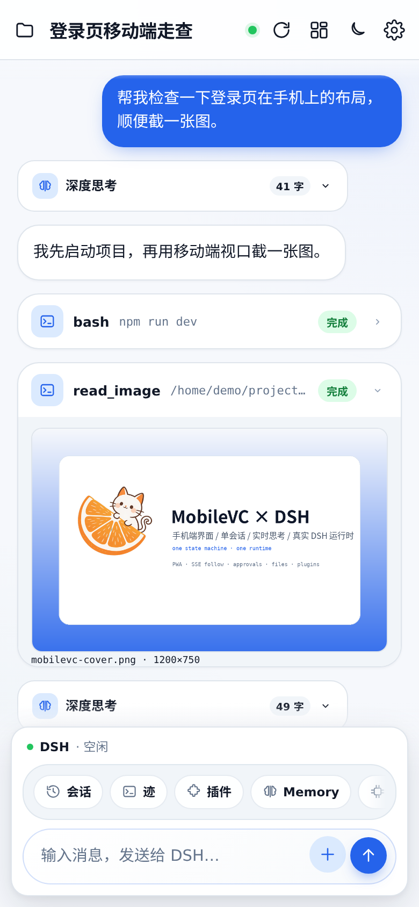
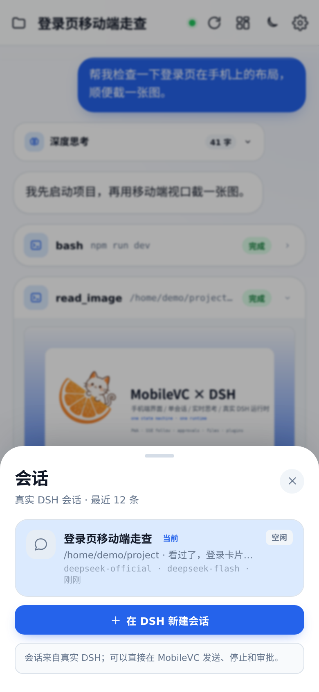
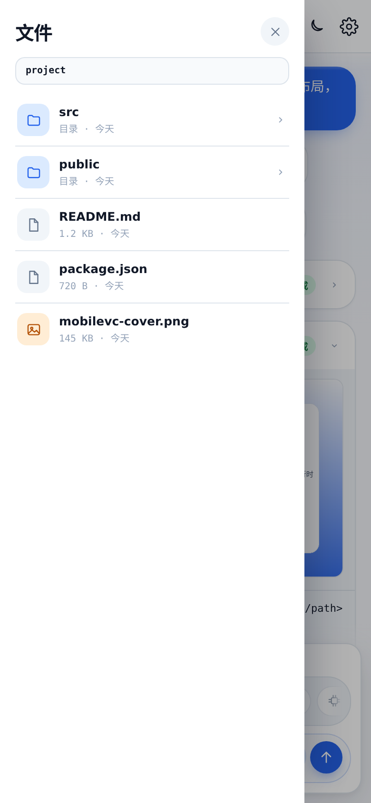
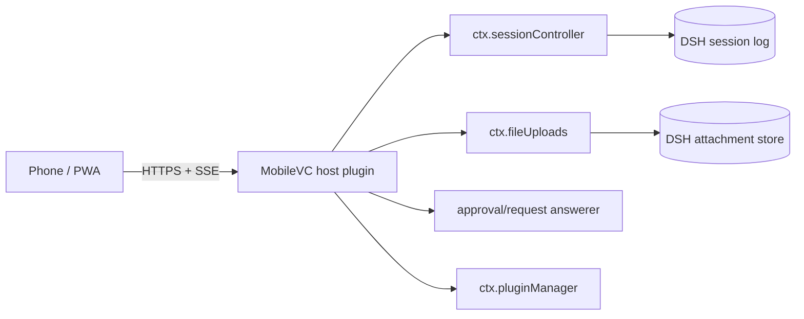

# MobileVC

**MobileVC-style mobile / PWA surface for [DeepSeek Harness](https://github.com/deepseek-ai/deepseek-harness).**

It is a DSH **host plugin** + static mobile UI. Not a second Agent, not a relay, not a copy of the session state machine.

<p align="center">
  
</p>

---

## 项目现状（2026-10）

**`main` 现在就是 MobileVC for DSH。**

原来的 Flutter 客户端 + Go relay 保留在 [`legacy/`](./legacy/)，只作为历史和参考，不再是默认客户端。

在把 MobileVC 接到 DSH 之后，方向发生了变化：

- DSH 已经提供 Agent runtime、durable session log、follow 流、tool call、审批、插件系统
- 如果继续维护 Flutter 客户端 + Go relay，等于在 DSH 之外再维护一套 session/queue/runtime
- 这正是旧版偶尔同步异常、队列丢失、中转策略混乱的根源

所以现在只保留一层：

> **DSH owns the runtime. MobileVC owns the surface.**

手机端不再同步会话，而是直接读同一个 `ctx.sessionController`。没有第二个 Agent，没有第二份 session log，没有 relay 队列。

## 现在是什么

**是**

- 一个给 DSH 用的手机/PWA 界面
- 真实发送、停止、审批、文件浏览、图片/文件附件、插件管理
- 一个可安装到 iOS/Android 主屏幕的 PWA
- MobileVC 移动端交互语言在 Web 上的延续

**不是**

- 原来的 Flutter MobileVC 客户端
- 原来的 Go relay / E2EE 传输
- 多租户 SaaS：所有登录用户看到同一个 DSH 用户的会话和文件
- 桌面 DSH Web 的替代品

## 截图

| 对话 / 工具 | 执行迹 |
|---|---|
|  |  |

| 插件管理 | 会话 |
|---|---|
|  |  |

| 文件浏览 |
|---|
|  |

## 功能

- **真实会话**：列表、切换、查看历史
- **Follow 流**：`sessionController.follow()`，durable events + `reasoning-delta` / `text-delta`
- **实时思考**：执行中“正在思考”逐字增长；结束后变成可折叠的“深度思考 · N 字”
- **工具卡**：默认折叠，显示工具名/参数/状态；点开看完整输出
- **read_image**：从 DSH attachment store 读原图，缩略图 + 全屏
- **附件**：图片作为 image part；文件通过 `ctx.fileUploads` receipt 发送
- **直接审批**：允许一次 / 拒绝；另一端已处理时点击自动失效
- **执行迹**：用户 → 思考 → 工具 → 回复 → 压缩的 DSH 风格 timeline
- **文件**：真实工作区，面包屑 + 逐级浏览
- **插件管理**：真实 `listPlugins` / `listBundles` / 开关；MobileVC 锁定自身
- **PWA**：manifest、图标、service worker、safe-area、禁双指/双击缩放
- **额度/错误可见**：`turn/end` 失败变成错误卡（例如 QUOTA 402）

## 架构



- `/mobilevc/api/follow` → `sessionController.follow({ assistantStream: true })`
- `/mobilevc/api/prompt` → `sessionController.prompt()`；图片直接作为 image part，文件先 `fileUploads.uploadStream()` 换 receipt
- `/mobilevc/api/approval` → 手机端 answerer；没有活跃 follow 时 `next()` 交回桌面
- `/mobilevc/api/plugins` → `pluginManager`
- 静态 UI 和 API 同源，不需要 CORS

## 安装

### 作为 DSH bundle（推荐）

```bash
dsh plugin --profile web add "github:JayCRL/MobileVC"
systemctl restart dsh-web
```

或本地 clone：

```bash
git clone https://github.com/JayCRL/MobileVC.git mobilevc
dsh plugin --profile web add ./mobilevc
systemctl restart dsh-web
```

打开：

```text
http://127.0.0.1:8898/mobilevc/
```

验证：

```bash
curl http://127.0.0.1:8898/mobilevc/api/health
# {"ok":true,"plugin":"mobilevc","interactive":true}
```

完整部署、nginx、PWA、升级/卸载、排错：[INSTALL.md](./INSTALL.md)。

> `/mobilevc/` 没有自己的登录页，必须放在认证 HTTPS 反向代理后面。

## 使用

- **+**：发送图片或文件
- **Enter** 发送，**Shift+Enter** 换行
- 运行中，发送键右侧红色脉冲按钮：打断当前 turn
- 点工具卡：展开命令输出
- 点 `read_image` 缩略图：全屏
- **迹**：执行 timeline
- **插件**：DSH 插件管理
- **Memory**：读写真实 `AGENTS.md`
- 审批卡：拒绝 / 允许一次

## 没有公网 IP 怎么办

浏览器无法直接连进 NAT 后的 DSH。两条路：

1. **单机/朋友**：Cloudflare Tunnel 或 Tailscale，把本机 8898 变成一个可达 URL；不改代码
2. **产品化**：中心 Relay + `mobilevc-connect` 插件，用户 DSH 主动外连；Relay 只做透明隧道，不存 session

当前仓库不内置 Relay；它只提供 `/mobilevc/` 的 Host plugin 和 UI。

## 安全边界

`/mobilevc/` 是 Host plugin 自己注册的路径，不走 DSH `/api` 的 browser-trust fence。它可以：

- 读所有会话、日志、工作区文件
- 发消息、停止、审批
- 写 `AGENTS.md`
- 上传图片/文件
- 启用/禁用 DSH 插件

所有登录用户共享同一个 DSH 身份，没有多租户隔离。公网必须使用认证 + HTTPS，不要把 8898 裸露。

## 方向

近期：

- 发布正式版本 / release
- 执行迹更细：step 分组、工具耗时
- 附件体验：粘贴、相机、拖拽
- 审批 presence：手机 follow 活跃时手机优先，否则桌面（已是当前行为）
- 可选原生壳复用同一套 PWA/HTTP surface；不引入第二套 session runtime

不做：

- 重写 Agent loop / session log
- 在插件里再塞一套 relay/E2EE
- 单 DSH 进程内做多租户隔离

## 目录

```text
plugin/index.mjs      Host plugin: /mobilevc + sessionController bridge
preview/              MobileVC UI (HTML/CSS/JS, no build)
tools/server.py       Optional read-only Python viewer
docs/images/          README screenshots
cordis.patch.yml      DSH bundle patch
package.json          DSH bundle metadata
INSTALL.md            Deployment / nginx / PWA / troubleshooting
legacy/               Original Flutter + Go relay MobileVC
```

## Legacy

原来的 Flutter + Go relay 代码在 [`legacy/`](./legacy/)。它仍然保留在 git 历史中，但：

- 不再作为默认客户端
- 不再推荐用于新部署
- 其中的 relay/session 同步思路已经被 DSH Host plugin 取代

## License

MIT — see [LICENSE](./LICENSE).
